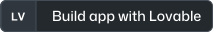
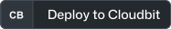
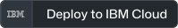

# TDK CLI template

## Build your app in one click

Fastest way (recommended): open the [TDK starter](https://github.com/tdk-landscape/tdk-cli-starter) in a ready-to-use environment.

<table align="center">
  <tr><td align="center" valign="middle" width="33%"><a href="https://v0.dev/"></a></td><td align="center" valign="middle" width="33%"><a href="https://replit.com/github/tdk-landscape/tdk-cli-starter"></a></td><td align="center" valign="middle" width="33%"><a href="https://gitpod.io/#https://github.com/tdk-landscape/tdk-cli-starter"></a></td></tr>
  <tr><td align="center" valign="middle" width="33%"><a href="https://lovable.dev/"></a></td><td align="center" valign="middle" width="33%"><a href="https://bolt.new/"></a></td><td align="center" valign="middle" width="33%"><a href="https://github.com/codespaces/new/tdk-landscape/tdk-cli-starter"></a></td></tr>
</table>

<details>
<summary>More build tools (6)</summary>

<table align="center">
  <tr><td align="center" valign="middle" width="33%"><a href="https://glitch.com/edit/#!/import/github/tdk-landscape/tdk-cli-starter"></a></td><td align="center" valign="middle" width="33%"><a href="https://devpod.sh/open#https://github.com/tdk-landscape/tdk-cli-starter"></a></td><td align="center" valign="middle" width="33%"><a href="https://stackblitz.com/github/tdk-landscape/tdk-cli-starter"></a></td></tr>
  <tr><td align="center" valign="middle" width="33%"><a href="https://codesandbox.io/p/github/tdk-landscape/tdk-cli-starter"></a></td><td align="center" valign="middle" width="33%"><a href="https://vscode.dev/redirect?url=vscode://ms-vscode-remote.remote-containers/cloneInVolume?url=https://github.com/tdk-landscape/tdk-cli-starter"></a></td><td align="center" valign="middle" width="33%"><a href="https://studio.firebase.google.com/import?url=https://github.com/tdk-landscape/tdk-cli-starter"></a></td></tr>
</table>

</details>

<table align="center">
  <tr><td align="center" valign="middle" width="33%"><a href="https://grok.com/?q=Build%20an%20app%20with%20the%20TDK%20CLI.%20Read%20the%20setup%20guide%20at%20https%3A%2F%2Fgithub.com%2Ftdk-landscape%2Ftdk-cli-starter%20and%20walk%20me%20through%20it%20step%20by%20step."></a></td><td align="center" valign="middle" width="33%"><a href="https://claude.ai/new?q=Build%20an%20app%20with%20the%20TDK%20CLI.%20Read%20the%20setup%20guide%20at%20https%3A%2F%2Fgithub.com%2Ftdk-landscape%2Ftdk-cli-starter%20and%20walk%20me%20through%20it%20step%20by%20step."></a></td><td align="center" valign="middle" width="33%"><a href="https://chatgpt.com/?q=Build%20an%20app%20with%20the%20TDK%20CLI.%20Read%20the%20setup%20guide%20at%20https%3A%2F%2Fgithub.com%2Ftdk-landscape%2Ftdk-cli-starter%20and%20walk%20me%20through%20it%20step%20by%20step."></a></td></tr>
</table>

### Deploy

<table align="center">
  <tr><td align="center" valign="middle" width="33%"><a href="https://claude.ai/new?q=Deploy%20the%20app%20I%20built%20with%20the%20TDK%20CLI%20to%20AWS.%20Read%20the%20setup%20guide%20at%20https%3A%2F%2Fgithub.com%2Ftdk-landscape%2Ftdk-cli-starter%20and%20walk%20me%20through%20it%20step%20by%20step."></a></td><td align="center" valign="middle" width="33%"><a href="https://claude.ai/new?q=Deploy%20the%20app%20I%20built%20with%20the%20TDK%20CLI%20to%20Azure.%20Read%20the%20setup%20guide%20at%20https%3A%2F%2Fgithub.com%2Ftdk-landscape%2Ftdk-cli-starter%20and%20walk%20me%20through%20it%20step%20by%20step."></a></td><td align="center" valign="middle" width="33%"><a href="https://claude.ai/new?q=Deploy%20the%20app%20I%20built%20with%20the%20TDK%20CLI%20to%20Vercel.%20Read%20the%20setup%20guide%20at%20https%3A%2F%2Fgithub.com%2Ftdk-landscape%2Ftdk-cli-starter%20and%20walk%20me%20through%20it%20step%20by%20step."></a></td></tr>
  <tr><td align="center" valign="middle" width="33%"><a href="https://claude.ai/new?q=Deploy%20the%20app%20I%20built%20with%20the%20TDK%20CLI%20to%20Netlify.%20Read%20the%20setup%20guide%20at%20https%3A%2F%2Fgithub.com%2Ftdk-landscape%2Ftdk-cli-starter%20and%20walk%20me%20through%20it%20step%20by%20step."></a></td><td align="center" valign="middle" width="33%"><a href="https://claude.ai/new?q=Deploy%20the%20app%20I%20built%20with%20the%20TDK%20CLI%20to%20Heroku.%20Read%20the%20setup%20guide%20at%20https%3A%2F%2Fgithub.com%2Ftdk-landscape%2Ftdk-cli-starter%20and%20walk%20me%20through%20it%20step%20by%20step."></a></td><td align="center" valign="middle" width="33%"><a href="https://claude.ai/new?q=Deploy%20the%20app%20I%20built%20with%20the%20TDK%20CLI%20to%20Railway.%20Read%20the%20setup%20guide%20at%20https%3A%2F%2Fgithub.com%2Ftdk-landscape%2Ftdk-cli-starter%20and%20walk%20me%20through%20it%20step%20by%20step."></a></td></tr>
  <tr><td align="center" valign="middle" width="33%"><a href="https://claude.ai/new?q=Deploy%20the%20app%20I%20built%20with%20the%20TDK%20CLI%20to%20Cloudflare.%20Read%20the%20setup%20guide%20at%20https%3A%2F%2Fgithub.com%2Ftdk-landscape%2Ftdk-cli-starter%20and%20walk%20me%20through%20it%20step%20by%20step."></a></td><td align="center" valign="middle" width="33%"><a href="https://claude.ai/new?q=Deploy%20the%20app%20I%20built%20with%20the%20TDK%20CLI%20to%20DigitalOcean.%20Read%20the%20setup%20guide%20at%20https%3A%2F%2Fgithub.com%2Ftdk-landscape%2Ftdk-cli-starter%20and%20walk%20me%20through%20it%20step%20by%20step."></a></td><td align="center" valign="middle" width="33%"><a href="https://claude.ai/new?q=Deploy%20the%20app%20I%20built%20with%20the%20TDK%20CLI%20to%20Google%20Cloud.%20Read%20the%20setup%20guide%20at%20https%3A%2F%2Fgithub.com%2Ftdk-landscape%2Ftdk-cli-starter%20and%20walk%20me%20through%20it%20step%20by%20step."></a></td></tr>
</table>

<details>
<summary>More clouds and hosts (18)</summary>

<table align="center">
  <tr><td align="center" valign="middle" width="33%"><a href="https://claude.ai/new?q=Deploy%20the%20app%20I%20built%20with%20the%20TDK%20CLI%20to%20SSH.%20Read%20the%20setup%20guide%20at%20https%3A%2F%2Fgithub.com%2Ftdk-landscape%2Ftdk-cli-starter%20and%20walk%20me%20through%20it%20step%20by%20step."></a></td><td align="center" valign="middle" width="33%"><a href="https://claude.ai/new?q=Deploy%20the%20app%20I%20built%20with%20the%20TDK%20CLI%20to%20Civo.%20Read%20the%20setup%20guide%20at%20https%3A%2F%2Fgithub.com%2Ftdk-landscape%2Ftdk-cli-starter%20and%20walk%20me%20through%20it%20step%20by%20step."></a></td><td align="center" valign="middle" width="33%"><a href="https://claude.ai/new?q=Deploy%20the%20app%20I%20built%20with%20the%20TDK%20CLI%20to%20Flow.%20Read%20the%20setup%20guide%20at%20https%3A%2F%2Fgithub.com%2Ftdk-landscape%2Ftdk-cli-starter%20and%20walk%20me%20through%20it%20step%20by%20step."></a></td></tr>
  <tr><td align="center" valign="middle" width="33%"><a href="https://claude.ai/new?q=Deploy%20the%20app%20I%20built%20with%20the%20TDK%20CLI%20to%20Vultr.%20Read%20the%20setup%20guide%20at%20https%3A%2F%2Fgithub.com%2Ftdk-landscape%2Ftdk-cli-starter%20and%20walk%20me%20through%20it%20step%20by%20step."></a></td><td align="center" valign="middle" width="33%"><a href="https://claude.ai/new?q=Deploy%20the%20app%20I%20built%20with%20the%20TDK%20CLI%20to%20Fly.io.%20Read%20the%20setup%20guide%20at%20https%3A%2F%2Fgithub.com%2Ftdk-landscape%2Ftdk-cli-starter%20and%20walk%20me%20through%20it%20step%20by%20step."></a></td><td align="center" valign="middle" width="33%"><a href="https://claude.ai/new?q=Deploy%20the%20app%20I%20built%20with%20the%20TDK%20CLI%20to%20Linode.%20Read%20the%20setup%20guide%20at%20https%3A%2F%2Fgithub.com%2Ftdk-landscape%2Ftdk-cli-starter%20and%20walk%20me%20through%20it%20step%20by%20step."></a></td></tr>
  <tr><td align="center" valign="middle" width="33%"><a href="https://claude.ai/new?q=Deploy%20the%20app%20I%20built%20with%20the%20TDK%20CLI%20to%20Render.%20Read%20the%20setup%20guide%20at%20https%3A%2F%2Fgithub.com%2Ftdk-landscape%2Ftdk-cli-starter%20and%20walk%20me%20through%20it%20step%20by%20step."></a></td><td align="center" valign="middle" width="33%"><a href="https://claude.ai/new?q=Deploy%20the%20app%20I%20built%20with%20the%20TDK%20CLI%20to%20Docker.%20Read%20the%20setup%20guide%20at%20https%3A%2F%2Fgithub.com%2Ftdk-landscape%2Ftdk-cli-starter%20and%20walk%20me%20through%20it%20step%20by%20step."></a></td><td align="center" valign="middle" width="33%"><a href="https://claude.ai/new?q=Deploy%20the%20app%20I%20built%20with%20the%20TDK%20CLI%20to%20Hetzner.%20Read%20the%20setup%20guide%20at%20https%3A%2F%2Fgithub.com%2Ftdk-landscape%2Ftdk-cli-starter%20and%20walk%20me%20through%20it%20step%20by%20step."></a></td></tr>
  <tr><td align="center" valign="middle" width="33%"><a href="https://claude.ai/new?q=Deploy%20the%20app%20I%20built%20with%20the%20TDK%20CLI%20to%20Cloudbit.%20Read%20the%20setup%20guide%20at%20https%3A%2F%2Fgithub.com%2Ftdk-landscape%2Ftdk-cli-starter%20and%20walk%20me%20through%20it%20step%20by%20step."></a></td><td align="center" valign="middle" width="33%"><a href="https://claude.ai/new?q=Deploy%20the%20app%20I%20built%20with%20the%20TDK%20CLI%20to%20Exoscale.%20Read%20the%20setup%20guide%20at%20https%3A%2F%2Fgithub.com%2Ftdk-landscape%2Ftdk-cli-starter%20and%20walk%20me%20through%20it%20step%20by%20step."></a></td><td align="center" valign="middle" width="33%"><a href="https://claude.ai/new?q=Deploy%20the%20app%20I%20built%20with%20the%20TDK%20CLI%20to%20Scaleway.%20Read%20the%20setup%20guide%20at%20https%3A%2F%2Fgithub.com%2Ftdk-landscape%2Ftdk-cli-starter%20and%20walk%20me%20through%20it%20step%20by%20step."></a></td></tr>
  <tr><td align="center" valign="middle" width="33%"><a href="https://claude.ai/new?q=Deploy%20the%20app%20I%20built%20with%20the%20TDK%20CLI%20to%20Multipass.%20Read%20the%20setup%20guide%20at%20https%3A%2F%2Fgithub.com%2Ftdk-landscape%2Ftdk-cli-starter%20and%20walk%20me%20through%20it%20step%20by%20step."></a></td><td align="center" valign="middle" width="33%"><a href="https://claude.ai/new?q=Deploy%20the%20app%20I%20built%20with%20the%20TDK%20CLI%20to%20OVHcloud.%20Read%20the%20setup%20guide%20at%20https%3A%2F%2Fgithub.com%2Ftdk-landscape%2Ftdk-cli-starter%20and%20walk%20me%20through%20it%20step%20by%20step."></a></td><td align="center" valign="middle" width="33%"><a href="https://claude.ai/new?q=Deploy%20the%20app%20I%20built%20with%20the%20TDK%20CLI%20to%20IBM%20Cloud.%20Read%20the%20setup%20guide%20at%20https%3A%2F%2Fgithub.com%2Ftdk-landscape%2Ftdk-cli-starter%20and%20walk%20me%20through%20it%20step%20by%20step."></a></td></tr>
  <tr><td align="center" valign="middle" width="33%"><a href="https://claude.ai/new?q=Deploy%20the%20app%20I%20built%20with%20the%20TDK%20CLI%20to%20Kubernetes.%20Read%20the%20setup%20guide%20at%20https%3A%2F%2Fgithub.com%2Ftdk-landscape%2Ftdk-cli-starter%20and%20walk%20me%20through%20it%20step%20by%20step."></a></td><td align="center" valign="middle" width="33%"><a href="https://claude.ai/new?q=Deploy%20the%20app%20I%20built%20with%20the%20TDK%20CLI%20to%20Oracle%20Cloud.%20Read%20the%20setup%20guide%20at%20https%3A%2F%2Fgithub.com%2Ftdk-landscape%2Ftdk-cli-starter%20and%20walk%20me%20through%20it%20step%20by%20step."></a></td><td align="center" valign="middle" width="33%"><a href="https://claude.ai/new?q=Deploy%20the%20app%20I%20built%20with%20the%20TDK%20CLI%20to%20OpenTelekomCloud.%20Read%20the%20setup%20guide%20at%20https%3A%2F%2Fgithub.com%2Ftdk-landscape%2Ftdk-cli-starter%20and%20walk%20me%20through%20it%20step%20by%20step."></a></td></tr>
</table>

</details>

### Build app with your AI agent

<table align="center">
  <tr><td align="center" valign="middle" width="33%"><a href="https://devin.ai"></a></td><td align="center" valign="middle" width="33%"><a href="https://openai.com/codex/"></a></td><td align="center" valign="middle" width="33%"><a href="https://cursor.com/link/prompt?text=Build%20an%20app%20with%20the%20TDK%20CLI.%20Read%20the%20setup%20guide%20at%20https%3A%2F%2Fgithub.com%2Ftdk-landscape%2Ftdk-cli-starter%20and%20walk%20me%20through%20it%20step%20by%20step."></a></td></tr>
  <tr><td align="center" valign="middle" width="33%"><a href="https://windsurf.com"></a></td><td align="center" valign="middle" width="33%"><a href="https://claude.ai/new?q=Build%20an%20app%20with%20the%20TDK%20CLI.%20Read%20the%20setup%20guide%20at%20https%3A%2F%2Fgithub.com%2Ftdk-landscape%2Ftdk-cli-starter%20and%20walk%20me%20through%20it%20step%20by%20step."></a></td><td align="center" valign="middle" width="33%"><a href="https://github.com/features/copilot"></a></td></tr>
</table>

<details>
<summary>More agents (6)</summary>

<table align="center">
  <tr><td align="center" valign="middle" width="33%"><a href="https://zed.dev"></a></td><td align="center" valign="middle" width="33%"><a href="https://aider.chat/"></a></td><td align="center" valign="middle" width="33%"><a href="https://coder.com"></a></td></tr>
  <tr><td align="center" valign="middle" width="33%"><a href="https://github.com/google-gemini/gemini-cli"></a></td><td align="center" valign="middle" width="33%"><a href="https://codeanywhere.com"></a></td><td align="center" valign="middle" width="33%"><a href="https://www.augmentcode.com"></a></td></tr>
</table>

</details>

## Make the app

```bash
mkdir shop && cd shop
tdk project --yes
tdk resource orders-api --type backend --stack shop --yes
```

`tdk project` creates the stack. `tdk resource` scaffolds a backend service named `orders-api`, served at `/api/orders`.

## Check the stack

Preview what will start before any container runs:

```bash
npm run tdk:dry-run
```

## Start the stack

`tdk up` needs Docker and Tilt on the machine. Run it on your own machine, or in a container that provides Docker:

```bash
npm run tdk:up
curl http://api.shop.localhost/api/orders/health
```

`tdk up` prints the host ports it chose, so use the URL it prints.

## Learn more

- [Quickstart](https://tdk-landscape.github.io/tdk-website/docs/quickstart/)
- [Examples](https://tdk-landscape.github.io/tdk-website/docs/examples/)
- [What TDK writes](https://github.com/tdk-landscape/tdk-cli-core/blob/main/docs/generated-files.md)
